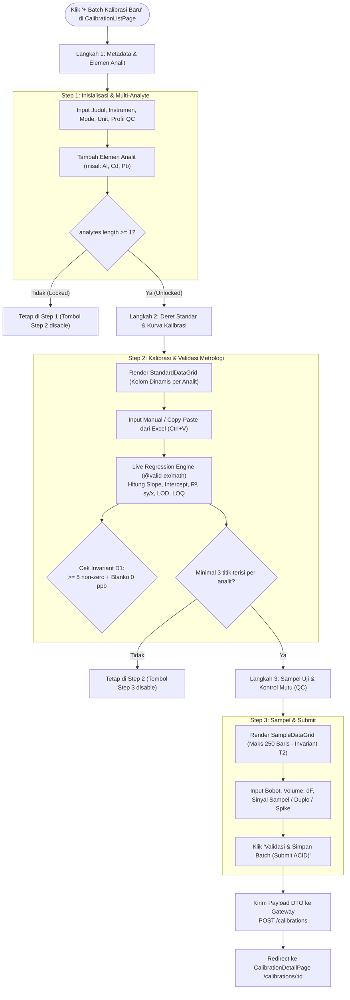
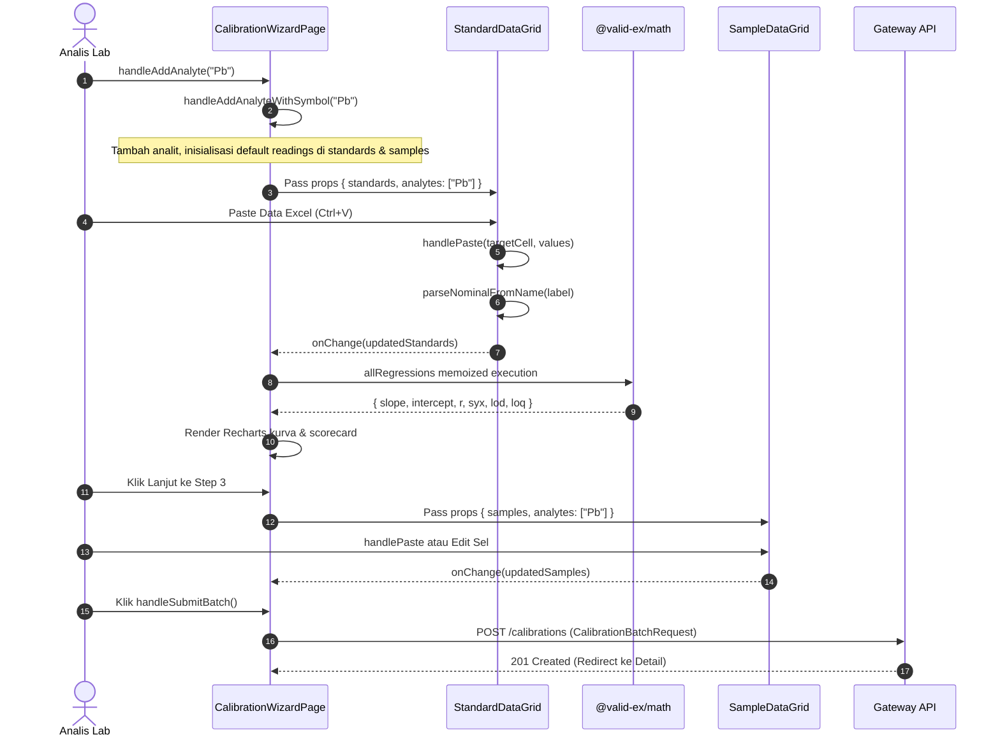

# 🧪 Dekonstruksi Lengkap Alur Kode `addCalibration` di `apps/web`

Dokumen ini membedah secara mendalam dan komprehensif seluruh alur kerja, fungsi, variabel, serta status persistensi dan penerusan data pada fitur penambahan batch kalibrasi baru (**Add Calibration**) di frontend Valid-Ex (`apps/web`).

---

## 🗺️ 1. Peta Komponen & Struktur File

Fitur penambahan kalibrasi diimplementasikan melalui pola **Progressive Multi-Step Wizard** yang terdiri dari 1 halaman orkestrator utama dan 2 subkomponen spreadsheet canvas berbasis `@glideapps/glide-data-grid`:

```
apps/web/src/
├── routes.tsx                                # Routing: Path '/calibrations/new'
└── features/calibration/
    ├── pages/
    │   ├── CalibrationListPage.tsx           # Entry point: Tombol '+ Batch Kalibrasi Baru'
    │   └── CalibrationWizardPage.tsx         # [ORCHESTRATOR UTAMA] State container 3 langkah
    └── components/
        ├── StandardDataGrid.tsx              # Grid interaktif deret standar + parser nominal
        └── SampleDataGrid.tsx                # Grid interaktif sampel uji (maks 250 baris - T2)
```

---

## 🔄 2. Alur Kerja Wizard 3-Langkah (Lifecycle & Flow)

Proses penambahan kalibrasi dibagi menjadi 3 tahapan progresif dengan validasi ketat (*Progressive Gating*):



---

## 📦 3. Analisis Variabel: Disimpan vs Diteruskan

Bagian ini merinci setiap variabel yang terlibat di seluruh alur `addCalibration`, tipenya, lokasinya, serta apakah variabel tersebut **disimpan** (dalam state lokal/memori) atau **diteruskan** (ke komponen anak, fungsi kalkulasi, atau backend).

### A. State Lokal di `CalibrationWizardPage.tsx`

| Nama Variabel | Tipe Data | Status (Disimpan / Diteruskan) | Scope & Mekanisme Alur |
| :--- | :--- | :--- | :--- |
| `step` | `1 \| 2 \| 3` | **Disimpan** (State Lokal) | Mengontrol tab wizard aktif. Berpindah saat tombol navigasi diklik atau otomatis di-reset oleh `useEffect` guard. |
| `title` | `string` | **Disimpan & Diteruskan** | Disimpan di state input form Step 1. Diteruskan ke payload `CalibrationBatchRequest.title` saat submit. |
| `instrument` | `string` | **Disimpan & Diteruskan** | Nilai instrumen (`ICP-MS`, `AAS`, dll). Diteruskan ke payload `CalibrationBatchRequest.instrument`. |
| `inputMode` | `'raw_signal' \| 'in_vial_concentration'` | **Disimpan & Diteruskan** | Mode data instrumen. Diteruskan ke payload `CalibrationBatchRequest.inputMode`. |
| `unit` | `string` | **Disimpan & Diteruskan** | Satuan konsentrasi larutan (`ppm`, `ppb`, `ppt`). Diteruskan ke payload `CalibrationBatchRequest.units.solutionConcUnit`. |
| `analytes` | `string[]` | **Disimpan & Diteruskan** | Array simbol analit aktif (misal `['Al', 'Cd', 'Pb']`). Disimpan di parent; **diteruskan sebagai props** ke `StandardDataGrid` dan `SampleDataGrid` untuk merender kolom dinamis; diteruskan ke engine `linearRegression`. |
| `newAnalyteInput` | `string` | **Disimpan Sementara** | Menyimpan teks yang sedang diketik user pada input analit Step 1. Direset ke `''` setelah analit ditambahkan. |
| `editingAnalyte` | `string \| null` | **Disimpan Sementara** | Menyimpan simbol analit yang sedang diedit namanya secara inline di Step 1. |
| `selectedAnalyte` | `string` | **Disimpan & Diteruskan** | Menyimpan simbol analit yang sedang aktif ditinjau kurvanya di Step 2. Diteruskan ke Recharts chart & metrology scorecard. |
| `quickAddAnalyteInput` | `string` | **Disimpan Sementara** | Menyimpan teks penambahan analit kilat di toolbar Step 2. Direset setelah submit. |
| `showQuickAdd` | `boolean` | **Disimpan Sementara** | Toggle modal/popover kecil penambahan analit di Step 2. |
| `standards` | `StandardRowItem[]` | **Disimpan & Diteruskan** | **State Krusial**: Array titik deret standar beserta sinyal masing-masing analit. Diteruskan ke `StandardDataGrid` via props `standards`, diterima kembali via `onChange(updated)`, diteruskan ke `linearRegression()`, dan dirakit ke DTO submit. |
| `samples` | `SampleRowState[]` | **Disimpan & Diteruskan** | **State Krusial**: Array baris sampel (MB, sample, CCV, spike, duplo). Diteruskan ke `SampleDataGrid` via props `samples`, diterima kembali via `onChange(updated)`, dan dirakit ke DTO submit. |
| `pasteNotice` | `string \| null` | **Disimpan Sementara** | Pesan toast sukses setelah copy-paste dari Excel. Otomatis hilang setelah 4 detik (`setTimeout`). |

---

### B. Derived State (Variabel Terkalkulasi via `useMemo`)

Variabel berikut tidak disimpan di state independen, melainkan dihitung ulang secara reaktif (*zero drift*) ketika dependensinya berubah:

| Nama Variabel | Formula / Dependensi | Peran & Alur |
| :--- | :--- | :--- |
| `canProceedToStep2` | `analytes.length > 0` | Mengunci (*lock*) tombol Step 2 jika belum ada minimal 1 analit. |
| `isStandardsFilled` | `standards.length >= 3 && analytes.every(...)` | Memeriksa apakah setiap analit memiliki minimal 3 titik dengan sinyal numerik valid. |
| `canProceedToStep3` | `canProceedToStep2 && isStandardsFilled` | Mengunci tombol Step 3 jika deret standar belum memenuhi syarat metrologi minimal ($df \ge 1$). |
| `allRegressions` | `[standards, analytes]` $\rightarrow$ `@valid-ex/math` | Memetakan setiap analit ke hasil regresi `linearRegression(points)`: `slope`, `intercept`, `r`, `rSquared`, `syx`, `lod`, `loq`. |
| `activeRegression` | `allRegressions[selectedAnalyte]` | Mengambil hasil regresi analit yang sedang aktif dipilih. |
| `nonZeroLevels` | `standards.filter(nominal > 0).length` | Menghitung jumlah konsentrasi non-zero untuk validasi **Invariant D1**. |
| `hasBlank` | `standards.some(nominal === 0)` | Mengecek keberadaan titik blanko untuk validasi **Invariant D1**. |
| `isInvariantD1Pass` | `nonZeroLevels >= 5 && hasBlank` | Menentukan apakah peringatan ISO 17025 harus dimunculkan di layar. |
| `chartData` | `[standards, selectedAnalyte, activeRegression]` | Array objek `{ nominal, actualSignal, fittedSignal, name }` untuk divisualisasikan oleh Recharts. |

---

### C. State Lokal di Komponen Grid (`StandardDataGrid` & `SampleDataGrid`)

Kedua subkomponen memiliki state visual independen yang **tidak diteruskan ke parent**:

- `colWidths`: `Record<string, number>` &mdash; Menyimpan ukuran lebar kolom hasil drag-resize user.
- `selection`: `GridSelection` &mdash; Menyimpan koordinat sel atau rentang baris yang sedang dipilih/diblok.

---

## ⚙️ 4. Rincian Fungsi & Handler yang Digunakan

Berikut adalah rincian seluruh fungsi di ketiga file komponen beserta pemicu (*trigger*), parameter, dan efek sampingnya:



---

### 1. Fungsi di `CalibrationWizardPage.tsx`

#### a. `handleAddAnalyteWithSymbol(rawSymbol: string)`
- **Pemicu**: Dipanggil saat analit baru ditambahkan (baik dari Step 1 via `handleAddAnalyte` maupun Step 2 via `handleQuickAddAnalyte`).
- **Logika Internal**:
  1. Melakukan sanitasi `rawSymbol.trim()` dan kapitalisasi huruf pertama (misal `pb` $\rightarrow$ `Pb`).
  2. Mengecek apakah analit sudah ada. Jika ada, cukup jadikan `selectedAnalyte = formatted`.
  3. Memperbarui `analytes` state: `[...prev, formatted]`.
  4. Mengambil profil sensitivitas default dari `sensitivityMap` (misal `Al`, `Cd`, `Mn`, `Pb`).
  5. Menginjeksi key analit baru ke seluruh baris `standards`:
     ```ts
     readings: {
       ...row.readings,
       [formatted]: {
         nominalConc: row.nominalConc,
         signal: row.nominalConc === 0 ? sens.intercept : (row.nominalConc * sens.slope + sens.intercept)
       }
     }
     ```
  6. Menginjeksi key analit baru ke seluruh baris `samples`.
  7. Menetapkan `selectedAnalyte` ke analit baru jika sebelumnya kosong.

#### b. `handleRenameAnalyte(oldSymbol: string, newSymbolRaw: string)`
- **Pemicu**: Selesai mengedit nama analit pada tag inline Step 1 (`onBlur` atau tombol `Enter`).
- **Logika Internal**:
  1. Validasi string kosong dan cek duplikasi nama baru.
  2. Memperbarui array `analytes`.
  3. Melakukan migrasi key pada `standards`: nilai pada `readings[oldSymbol]` dipindahkan ke `readings[formatted]`, kemudian `delete readings[oldSymbol]`.
  4. Melakukan migrasi key yang sama pada `samples`.
  5. Jika analit yang diganti namanya sedang dipilih di `selectedAnalyte`, perbarui nilainya.
  6. Reset `editingAnalyte = null`.

#### c. `handleRemoveAnalyte(symbol: string)`
- **Pemicu**: Tombol silang (`X`) pada badge analit di Step 1 diklik.
- **Logika Internal**:
  1. Menghapus simbol dari array `analytes`.
  2. Menghapus properti `readings[symbol]` dari setiap baris di `standards` dan `samples` agar memori bersih (*no memory leak*).
  3. Memperbarui `selectedAnalyte` ke elemen tersisa pertama.

#### d. `handleSubmitBatch()`
- **Pemicu**: Tombol *"Validasi & Simpan Batch (Submit ACID)"* di Step 3 diklik.
- **Logika Internal**:
  - Mengarahkan router ke halaman detail batch via `navigate('/calibrations/batch-demo-1')`.
  - *Pada integrasi produksi*: Merakit objek DTO `CalibrationBatchRequest` (sesuai spesifikasi OpenAPI `packages/contracts/openapi.yaml`) dan mengirimkan HTTP `POST /calibrations` ke `apps/gateway`.

---

### 2. Fungsi di `StandardDataGrid.tsx`

#### a. `parseNominalFromName(name: string, fallback: number): number`
- **Tujuan**: Helper utilitas untuk mengekstrak konsentrasi nominal secara otomatis dari teks label standar saat user mengetik atau menempel data dari Excel.
- **Aturan Parsing**:
  - Kata `'blank'`, `'blanko'`, `'0'`, atau `'calblank'` $\rightarrow$ menghasilkan nilai `0`.
  - Menggunakan regex `match(/(\d+(\.\d+)?)/)` untuk menangkap angka pertama (misal `'Std 50'` $\rightarrow$ `50`, `'Cal 0.5'` $\rightarrow$ `0.5`).
  - Jika tidak ada angka, mengembalikan nilai `fallback`.

#### b. `getCellContent(cell: Item): GridCell`
- **Pemicu**: Callback performa tinggi yang dipanggil oleh Glide Data Grid saat merender sel di canvas virtual.
- **Logika Internal**:
  - `col === 0`: Mengembalikan `GridCellKind.Text` untuk `standardName`.
  - `col >= 1`: Mencari pembacaan sinyal `standards[row].readings[analyte]?.signal` dan mengembalikan `GridCellKind.Number`.

#### c. `handleCellEdited(cell: Item, newValue: EditableGridCell)`
- **Pemicu**: Pengguna selesai mengedit satu sel secara langsung di data grid.
- **Logika Internal**:
  - Jika `col === 0` (Label diedit): Nama standar diperbarui, nominal konsentrasi di-parse ulang via `parseNominalFromName`, dan disinkronkan ke seluruh objek `readings[a].nominalConc`.
  - Jika `col >= 1` (Sinyal analit diedit): Mengupdate nilai `signal` untuk analit terkait.
  - Memanggil `onChange(updated)` untuk meneruskan state baru ke `CalibrationWizardPage`.

#### d. `handlePaste(target: Item, values: readonly (readonly string[])[]): boolean`
- **Pemicu**: Event clipboard paste (<kbd>Ctrl+V</kbd> / <kbd>Cmd+V</kbd>) dari Excel/Spreadsheet.
- **Logika Internal**:
  1. Menerima matriks string 2 dimensi dari clipboard.
  2. Melakukan ekspansi otomatis baris standar jika jumlah baris paste melebihi baris yang ada di tabel.
  3. Memetakan nilai per kolom: kolom 0 untuk label & ekstraksi nominal, kolom $\ge 1$ untuk sinyal numerik analit.
  4. Memanggil `onChange(updated)`.
  5. Memanggil `onNotice(...)` untuk menampilkan banner notifikasi jumlah baris dan kolom yang berhasil ditempel.

#### e. `handleAddRow()` & `handleDeleteSelected()` / `handleDeleteCallback()`
- **Tujuan**: Menambah baris standar baru atau menghapus baris yang dipilih.
- **Proteksi Domain**: Menolak penghapusan jika sisa baris standar $< 3$ titik (karena regresi linear OLS membutuhkan derajat kebebasan $df = n - 2 \ge 1$).

---

### 3. Fungsi di `SampleDataGrid.tsx`

#### a. `getCellContent(cell: Item): GridCell`
- Memetakan 6 kolom basis metrologi laboratorium:
  - `col === 0`: `id` (`Sample ID`)
  - `col === 1`: `type` (`blank_method`, `sample`, `ccv`, `spike`, `duplicate`)
  - `col === 2`: `parent` (`Parent ID` untuk duplo/spike)
  - `col === 3`: `weight` (Bobot penimbangan dalam gram)
  - `col === 4`: `vol` (Volume pelarutan dalam mL)
  - `col === 5`: `df` (Faktor pengenceran)
  - `col >= 6`: Sinyal instrumen untuk masing-masing analit (`sample.readings[analyte]`).

#### b. `handleCellEdited(cell: Item, newValue: EditableGridCell)`
- Memvalidasi dan memperbarui tipe data kolom yang diedit (misal memastikan `type` hanya menerima enum valid, atau mengonversi nilai numerik bobot/volume/df/sinyal).
- Memanggil `onChange(updated)`.

#### c. `handlePaste(target: Item, values: readonly (readonly string[])[]): boolean`
- **Penegakan Invariant T2 (Bounded Payload Limit)**:
  ```ts
  if (targetRow >= 250) return; // Mencegah payload meledak di serverless gateway
  ```
  Data paste yang melebihi batas 250 baris diabaikan secara aman untuk menjaga konsumsi memori V8 gateway $< 64\text{ MB}$.
- Memperbarui kolom basis atau kolom sinyal analit sesuai offset sel target yang diklik user.
- Memanggil `onChange(updated)` dan `onNotice(...)`.

#### d. `handleAddSample()` & `handleDeleteSelected()`
- Menambah baris sampel baru (terkunci jika sudah mencapai 250 baris).
- Menghapus baris terpilih (terkunci jika hanya tersisa 1 sampel).

---

## 🏛️ 5. Keterkaitan dengan Domain Invariant Valid-Ex

Alur kode `addCalibration` ini dibangun selaras dengan aturan metrologi dan teknis proyek:

1. **Multi-Element Independence (Invariant D2)**:
   - Setiap analit memiliki kurva regresi sendiri yang terisolasi di `allRegressions[analyte]`.
   - Perubahan sinyal pada elemen `Al` sama sekali tidak memengaruhi regresi elemen `Pb` atau `Cd`.
2. **5 Non-Zero + Blank Verification (Invariant D1)**:
   - Di Step 2, `isInvariantD1Pass` secara live menghitung keberadaan titik blanko (nominal 0) dan minimal 5 titik non-zero. Jika tidak terpenuhi, sistem menampilkan *alert* peringatan standar ISO/IEC 17025.
3. **Data Integrity & Anti-CWE-1236 (Invariant T1)**:
   - Seluruh nilai teks yang dimasukkan user (`title`, `sampleId`, label) disanitasi sebelum nantinya dituliskan sebagai formula native Excel di sisi gateway.
4. **Governed QC Profiles (Invariant D4)**:
   - Form Step 1 mengunci profil kriteria mutu ke referensi SOP terdaftar (`sop-rev1`), mencegah nilai batas evaluasi di-hardcode secara sepihak.

---

## 📋 6. Ringkasan Siklus Data (Data Flow Lifecycle)

```
[Input Excel / Keyboard]
       │
       ▼
[StandardDataGrid / SampleDataGrid]
       │ (onChange callback)
       ▼
[State standards & samples di CalibrationWizardPage]
       │
       ├─► [@valid-ex/math: linearRegression()] ──► [Live Chart & Metrology Metrics]
       │
       └─► [handleSubmitBatch()]
                 │
                 ▼ (Payload DTO: CalibrationBatchRequest)
           [POST /calibrations di apps/gateway]
                 │
                 ├─► [Zod Contract Validation]
                 ├─► [ACID Persistence via Drizzle ORM di packages/db]
                 └─► [Redirect ke /calibrations/:id]
```

Dokumentasi ini mencakup seluruh arsitektur data, state management, dan fungsi operasional dari fitur `addCalibration`. Seluruh logika dirancang murni reaktif, bebas drift, dan terikat langsung pada single source of truth kontrak API.
