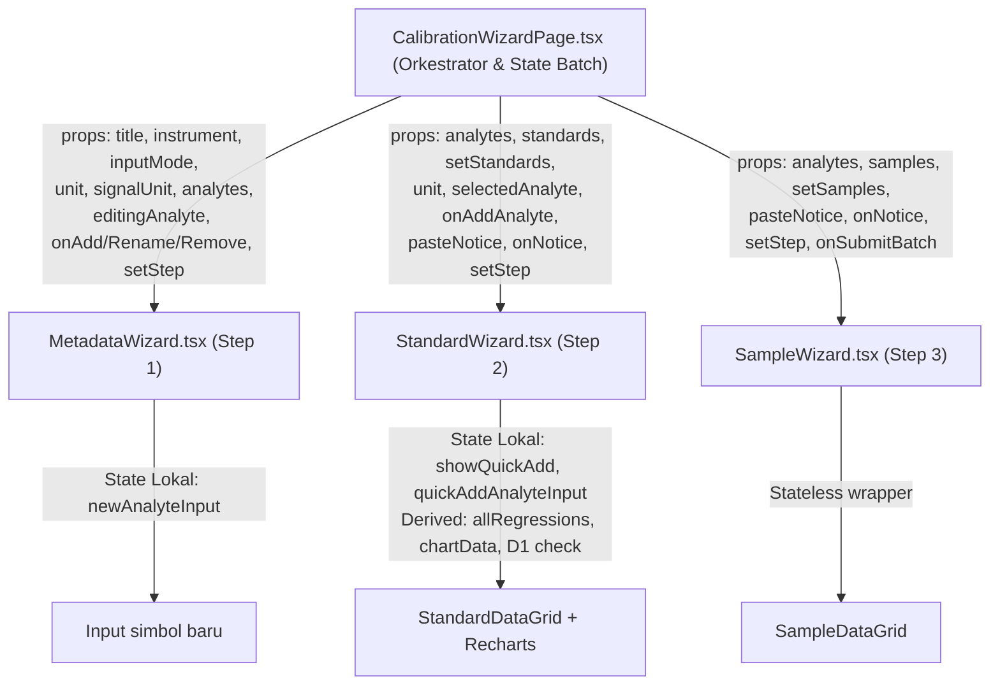

# Ringkasan Refactor Modul Kalibrasi Frontend (`refactor/web-wizard`)

Dokumen ini merangkum seluruh pekerjaan restrukturisasi komponen, pengetatan tipe terhadap OpenAPI contract (`@valid-ex/contracts`), standarisasi formatting, serta keputusan arsitektur yang dilakukan pada fitur kalibrasi di `apps/web` pada branch `refactor/web-wizard`.

---

## 1. Peta Struktur Modul Terbaru

```text
apps/web/src/features/calibration/
├── pages/
│   ├── CalibrationListPage.tsx        (169 baris) — Riwayat batch kalibrasi (dipertahankan utuh)
│   ├── CalibrationWizardPage.tsx      (299 baris) — Orkestrator 3 langkah & sumber state batch
│   └── CalibrationDetailPage.tsx      (326 baris) — Orkestrator detail evaluasi & filter analit
└── components/
    ├── MetadataWizard.tsx             (273 baris) — Step 1: Metadata uji, unit, & daftar analit
    ├── StandardWizard.tsx             (501 baris) — Step 2: Grid standar, regresi live, & kurva OLS
    ├── SampleWizard.tsx               (87 baris)  — Step 3: Grid sampel uji & tombol submit batch
    ├── StandardDataGrid.tsx           (450 baris) — Canvas DataGrid standar (paste Excel)
    ├── SampleDataGrid.tsx             (494 baris) — Canvas DataGrid sampel (maks 250 baris)
    ├── AnalyteQcBanner.tsx            (55 baris)  — Status QC per analit (OOS Soft-Flag / PASSED)
    ├── CalibrationCurveSection.tsx    (162 baris) — Plot kurva Recharts, 3 kartu metrik, & deret baku
    └── SampleEvaluationTable.tsx      (133 baris) — Tabel hasil 3-zona, QC, & tombol ekspor .xlsx
```

---

## 2. Ringkasan Pekerjaan per Area

### A. Standarisasi Formatting & Kontrak Tipe

- **Prettier Setup (`46b7895`)**: Penambahan `.prettierrc.json`, `.prettierignore`, `.editorconfig`, `.vscode/extensions.json`, serta script `format` dan `format:check` di `package.json`.
- **Single Source of Truth (`@valid-ex/contracts`)**:
  - Tipe metadata dan daftar analit di `CalibrationWizardPage.tsx`, `MetadataWizard.tsx`, `StandardWizard.tsx`, dan `SampleWizard.tsx` diturunkan langsung dari `components['schemas']` (`InstrumentType`, `InputMode`, `MetrologyUnits['solutionConcUnit']`, `MetrologyUnits['signalUnit']`, `CalibrationBatchRequest['title']`, `CalibrationBatchRequest['analytes']`).
  - `SampleEvaluationTable.tsx` mengaitkan `sampleType` pada `SampleAnalyteResult` ke `components['schemas']['SampleType']`.

---

### B. Refactor `CalibrationWizardPage.tsx` (3-Step Wizard)

`CalibrationWizardPage.tsx` dipecah dari satu file monolitik menjadi satu orkestrator ringkas (299 baris) yang membawahi tiga komponen langkah:



Pembagian tanggung jawab dan state:

1. **[`MetadataWizard.tsx`](../apps/web/src/features/calibration/components/MetadataWizard.tsx)**
   - **Props**: seluruh metadata batch (`title`, `instrument`, `inputMode`, `signalUnit`, `unit`), daftar `analytes`, `editingAnalyte` beserta handler mutasi (`onAddAnalyte`, `handleRenameAnalyte`, `handleRemoveAnalyte`), dan kontrol gating step (`canProceedToStep2`, `setStep`).
   - **State Lokal**: `newAnalyteInput` (teks sementara sebelum disubmit ke daftar analit).
2. **[`StandardWizard.tsx`](../apps/web/src/features/calibration/components/StandardWizard.tsx)**
   - **Props**: `analytes`, `standards`, `setStandards`, `unit`, `selectedAnalyte`, `setSelectedAnalyte`, `onAddAnalyte`, `pasteNotice`, `onNotice`, `canProceedToStep3`, `setStep`.
   - **State Lokal**: `showQuickAdd` dan `quickAddAnalyteInput` (toggle form tambah analit kilat di toolbar Step 2).
   - **Kalkulasi Lokal (`useMemo`)**: `allRegressions` via `linearRegression` dari `@valid-ex/math`, `activeRegression`, pemeriksaan `Invariant D1` (`nonZeroLevels >= 5 && hasBlank`), dan transformasi `chartData`.
3. **[`SampleWizard.tsx`](../apps/web/src/features/calibration/components/SampleWizard.tsx)**
   - **Props**: `analytes`, `samples`, `setSamples`, `pasteNotice`, `onNotice`, `setStep`, `onSubmitBatch`.
   - **State Lokal**: tidak ada (_stateless container_); seluruh interaksi grid internal ditangani oleh `SampleDataGrid.tsx`.
4. **Helper Bersama di Induk**:
   - `handleNotice(msg)` memusatkan timer toast 4 detik untuk dipakai bersama oleh `StandardWizard` (Step 2) dan `SampleWizard` (Step 3).
   - `selectedAnalyte` dipertahankan di induk agar tetap sinkron dengan `handleAddAnalyteWithSymbol`, `handleRenameAnalyte`, dan `handleRemoveAnalyte` tanpa risiko _stale state_.

---

### C. Refactor `CalibrationDetailPage.tsx`

Halaman detail batch dirampingkan dari 618 baris menjadi 326 baris (mayoritas baris yang tersisa saat ini adalah konstanta data mockup `ANALYTE_CURVES` dan `SAMPLE_RESULTS`):

1. **[`AnalyteQcBanner.tsx`](../apps/web/src/features/calibration/components/AnalyteQcBanner.tsx)**
   - Menerima `analyteName` dan `analyteSymbol`, menampilkan detail penyimpangan QC (_Soft-Flag Audit Trail_) atau banner `QC PASSED`.
2. **[`CalibrationCurveSection.tsx`](../apps/web/src/features/calibration/components/CalibrationCurveSection.tsx)**
   - Menggabungkan plot kurva Recharts (`chartData` via `useMemo`), 3 kartu metrik (`Slope`, `Intercept`, `R²`), dan tabel deret standar dalam satu komponen yang menerima `curve: AnalyteCurveData`.
   - Sengaja tidak dipecah menjadi file terpisah antara kartu grafik dan tabel deret baku karena keduanya selalu tampil berpasangan untuk satu objek `curve`.
3. **[`SampleEvaluationTable.tsx`](../apps/web/src/features/calibration/components/SampleEvaluationTable.tsx)**
   - Komponen tabel presentasional yang menerima `analyteName`, `analyteSymbol`, `samples`, dan `onDownload`.
4. **Bagian yang Dipertahankan di `CalibrationDetailPage.tsx`**:
   - **Header batch**, **banner `downloadToast`** (9 baris), dan **filter `selectedAnalyte`** sengaja tetap di halaman induk karena menjadi pusat koordinasi antar-komponen dan menjaga agar struktur tidak mengalami _over-fragmentation_.

---

### D. Halaman yang Dipertahankan Utuh

- **[`CalibrationListPage.tsx`](../apps/web/src/features/calibration/pages/CalibrationListPage.tsx)** (169 baris): tidak dipecah karena hanya berisi pencarian sederhana dan satu tabel daftar batch.

---

## 3. Keputusan Arsitektur Penting

1. **Batas `props` vs state lokal ditentukan oleh siklus hidup (_unmounting_) & dampak lintas-step**:
   Wizard merender langkah secara kondisional (`step === 1`, `step === 2`, `step === 3`). Setiap kali berpindah langkah, komponen sebelumnya di-_unmount_. Data domain yang harus bertahan antar-langkah atau dibutuhkan saat submit (`title`, `unit`, `analytes`, `standards`, `samples`, `selectedAnalyte`) wajib tinggal di induk; state UI sesaat (`newAnalyteInput`, `showQuickAdd`) aman di lokal.
2. **Menghindari _Premature Abstraction_ pada Grafik Regresi**:
   `StandardWizard.tsx` (kalkulasi live client `@valid-ex/math` dengan 6 kartu metrik + scorecard semua analit) dan `CalibrationCurveSection.tsx` (tampilan hasil tersimpan dengan 3 kartu metrik + tabel deret standar) sengaja belum disatukan menjadi satu komponen chart generik. Penyatuan baru dievaluasi setelah `CalibrationDetailPage.tsx` tersambung ke respons API asli.
3. **Menghindari _Over-Fragmentation_**:
   Blok kecil milik satu halaman (seperti `downloadToast`, header, atau bar filter) tidak dipisah ke file sendiri selama tidak dipakai lintas halaman dan ukuran halaman induk masih terkendali.

---

## 4. Riwayat Commit & Status Verifikasi

Commit pada branch `refactor/web-wizard` (di atas `main` `1be7c5c`):

- `992fe66` — `refactor: MetadataWizard`
- `4480d6d` — `add: type for state`
- `46b7895` — `refactor: prettier implementation`
- `f9d2b3a` — `refactor: step 2 to StandardWizard`
- `e5628a6` — `refactor: step 3 to SampleWizard`
- `a2791c5` — `refactor: table calibration detail`
- _(Working tree saat ini)_ — Ekstraksi `CalibrationCurveSection.tsx` & `AnalyteQcBanner.tsx` pada `CalibrationDetailPage.tsx`.

Hasil pengecekan terakhir sebelum dokumentasi:

- `pnpm typecheck` (`pnpm -r typecheck`): lulus (`0` error di `packages/contracts`, `packages/math`, `packages/db`, `apps/web`, `apps/gateway`).
- `pnpm format:check` (`prettier --check .`): lulus sesuai aturan Prettier.

---

## 5. Rencana Lanjutan (Fase Integrasi API)

- **Sinkronisasi `QcProfilesPage` & `MetadataWizard`**:
  - Mengganti dropdown profil QC statis (`sop-rev1`) di `MetadataWizard.tsx` dengan daftar profil dari `GET /qc-profiles` serta state `qcProfileId` di `CalibrationWizardPage.tsx`.
  - Membangun form pembuatan profil baru (`POST /qc-profiles`) pada `QcProfilesPage.tsx` (atau via modal dari wizard agar state pengisian wizard tidak hilang saat pindah rute), lalu menambahkan tautan/tombol aksi **di bawah** elemen `<select>` (bukan di dalam `<option>`).
- **Integrasi Data Nyata di Wizard & Detail**:
  - Menghubungkan `handleSubmitBatch` di `CalibrationWizardPage.tsx` ke `POST /calibrations`.
  - Mengganti data mockup di `CalibrationDetailPage.tsx` dengan fetch `GET /calibrations/:id`, menyelaraskan `AnalyteCurveData`, `SampleAnalyteResult`, dan `AnalyteQcBanner` ke `CalibrationBatchResponse` & `QCViolationRecord` (`@valid-ex/contracts`), serta membuat label satuan (`ppb`, `cps`, `mg/kg`) dinamis mengikuti `MetrologyUnits`.
  - Mengimplementasikan unduhan `.xlsx` asli melalui `GET /calibrations/{id}/samples/{sampleRowId}/export`.
